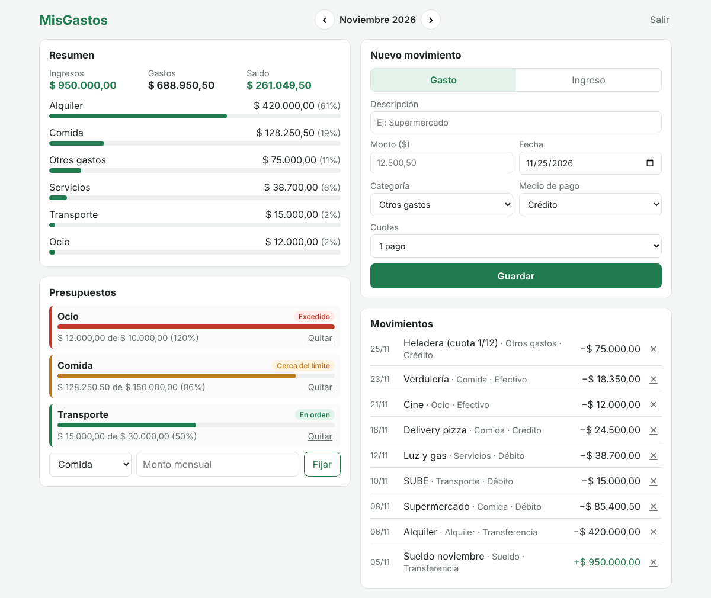

# MisGastos — control de gastos personales

App web para registrar gastos e ingresos, ver el resumen del mes, controlar compras en cuotas y recibir un aviso antes de pasarse del presupuesto.

Trabajo Práctico Final — Bootcamp Generación T · Nazir Molina



## Qué hace
- Registrar gastos e ingresos en segundos, con categoría, fecha y medio de pago (HU-01).
- Ver los movimientos de cada mes y moverse entre meses (HU-02).
- Resumen del mes: ingresos, gastos, saldo y en qué categorías se gasta más (HU-03).
- Compras con tarjeta en 2 a 24 cuotas: cada cuota aparece en su mes (HU-04).
- Eliminar movimientos; eliminar una cuota borra toda la compra (HU-05).
- Presupuesto por categoría con aviso: En orden / Cerca del límite / Excedido (HU-06).
- Login: los datos solo los ve su dueño (HU-07).

## Cómo se trabajó: la spec manda
Este proyecto sigue el flujo **spec → plan → tareas → test rojo → test verde → refactor**. Las reglas no se inventan: lo que la spec no dice se registra como pregunta abierta y se resuelve antes de implementarlo.

| Documento | Para qué |
|---|---|
| [`docs/spec.md`](docs/spec.md) | Reglas de negocio (RN) e historias de usuario (HU). Fuente de verdad. |
| [`docs/glossary.md`](docs/glossary.md) | Vocabulario común. |
| [`docs/preguntas-abiertas.md`](docs/preguntas-abiertas.md) | Lo que la spec no definía, con la decisión tomada (PA). |
| [`docs/plan-tecnico.md`](docs/plan-tecnico.md) | Arquitectura y decisiones técnicas (ADR). |
| [`docs/api.md`](docs/api.md) | Contrato entre frontend y backend. |
| [`docs/tareas.md`](docs/tareas.md) | Tareas, cada una con su RN/HU, y estado de la verificación. |
| [`AGENTS.md`](AGENTS.md) | Reglas y roles para trabajar con agentes de IA. |
| [`.cursor/agents/revisor.md`](.cursor/agents/revisor.md) | Agente revisor de seguridad y robustez (solo lectura). |
| [`.cursor/rules/spec-primero.mdc`](.cursor/rules/spec-primero.mdc) | Reglas que Cursor aplica siempre. |

## Estructura
```
misgastos/
├── docs/                 especificación, plan, API, preguntas, tareas, capturas
├── backend/              Node + Express + TypeScript
│   ├── migrations/       SQL versionado
│   ├── src/
│   │   ├── domain/       reglas puras (sin Express ni base): tiempo, movimiento, cuotas, resumen, presupuesto
│   │   ├── routes/       → controllers/ → services/ → repositories/   (capas estrictas)
│   │   ├── middlewares/  sesión (401) y manejo de errores
│   │   └── db/           conexión (pg o PGlite) y migraciones
│   └── tests/            dominio + API contra PostgreSQL real (PGlite)
├── frontend/             React + TypeScript (Vite)
├── AGENTS.md  ·  .cursor/
├── render.yaml           backend en Render
└── .github/workflows/    CI: typecheck, tests y build
```

## Puesta en marcha local
No hace falta instalar PostgreSQL: si `DATABASE_URL` está vacía, el backend usa **PGlite** (PostgreSQL real que corre dentro de Node) y guarda los datos en `backend/.data/`.

```bash
# Backend (http://localhost:3000)
cd backend
cp .env.example .env        # completar JWT_SECRET (32+ caracteres), USUARIO_EMAIL y USUARIO_PASSWORD
npm install
npm test                    # 82 tests
npm run dev

# Frontend (http://localhost:5173), en otra terminal
cd frontend
npm install
npm test                    # 21 tests
npm run dev
```
Entrar con el email y la contraseña definidos en `backend/.env`.

## Despliegue
| Parte | Servicio | Variables |
|---|---|---|
| Frontend | Netlify (`frontend/netlify.toml`) | `VITE_API_URL` = URL del backend en Render |
| Backend | Render (`render.yaml`) | `DATABASE_URL`, `CORS_ORIGIN`, `JWT_SECRET`, `USUARIO_EMAIL`, `USUARIO_PASSWORD` |
| Base de datos | Neon (PostgreSQL) | — (su cadena de conexión va en `DATABASE_URL` de Render) |

Las migraciones se aplican solas al arrancar el backend. Con todo configurado, publicar es hacer `git push` a `main`: el CI corre los tests y Render y Netlify vuelven a desplegar.

> El plan gratuito de Render "duerme" el backend: el primer pedido después de un rato puede tardar unos 30 segundos.
